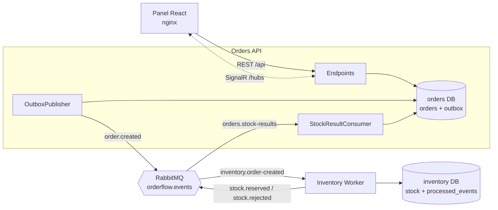

# OrderFlow

Sistema de pedidos con reserva de inventario asíncrona: **Orders API** (.NET 8), **Inventory Worker** (.NET 8), **RabbitMQ**, **PostgreSQL** y un **panel web** (React + TypeScript) con actualización en tiempo real (SignalR) y polling de respaldo.

---

## 1. Levantar todo (≈ 3 minutos)

Requisito: Docker Desktop (o Docker Engine + Compose v2).

```bash
docker compose up --build
```

| Qué | URL |
|---|---|
| **Panel web** | http://localhost:8080 |
| Orders API (directa) | http://localhost:5000/orders |
| RabbitMQ (UI) | http://localhost:15672 — usuario `orderflow` / `orderflow_dev` |

No hace falta ningún paso manual: Postgres y RabbitMQ arrancan con healthchecks, cada servicio crea su esquema y carga el **seed** al iniciar:

| SKU | Producto | Stock inicial |
|---|---|---|
| ABC-01 | Teclado mecánico | 100 |
| ABC-02 | Mouse inalámbrico | 50 |
| ABC-03 | Monitor 27" | 5 |
| ABC-04 | Webcam HD | **0** (para ver un rechazo) |

**Prueba rápida en el panel:** crea un pedido de `ABC-01` → aparece como *Pendiente* y en ~1 s pasa a *Confirmado*. Crea uno de `ABC-04` → *Rechazado* ("Stock insuficiente"). Envía el formulario vacío o con cantidad 0 / un SKU inexistente → errores bajo cada campo.

Para empezar de cero: `docker compose down -v` (borra los volúmenes).

### Tests

```bash
docker compose run --rm tests        # backend (no requiere el SDK de .NET instalado)
```

Alternativas con herramientas locales: `dotnet test backend/OrderFlow.sln` · `cd frontend && npm install && npm test`.

Son 5 tests backend (12 ejecuciones, porque 2 son `[Theory]` con varios casos), sobre la lógica crítica:

| Test | Cubre |
|---|---|
| `MismoEventoProcesadoDosVeces_DescuentaStockUnaSolaVez` | idempotencia del consumidor |
| `StockInsuficiente_RechazaSinModificarStock` | rechazo sin efectos secundarios |
| `SoloPendingPuedeTransicionar_EstadosFinalesIgnoranEventosPosteriores` | transiciones de estado |
| `Validacion_DatosInvalidos_DevuelveErrorEnElCampoCorrespondiente` | validación del pedido |
| `CrearPedidoValido_GuardaPendingYEventoOrderCreatedEnElOutbox` | pedido + evento en la misma transacción |

Usan SQLite en memoria (BD relacional real: transacciones, PK, `ExecuteUpdate`) en lugar del provider InMemory de EF, que no es relacional.

---

## 2. Arquitectura



**Flujo de un pedido**

1. `POST /orders` valida y guarda, **en una sola transacción**, el pedido (`Pending`) y el evento `OrderCreated` en la tabla `outbox_messages`. Responde `201`.
2. `OutboxPublisher` (en segundo plano) publica los eventos pendientes en RabbitMQ con *publisher confirms* y los marca como publicados.
3. `Inventory Worker` consume `OrderCreated`, descuenta el stock de forma atómica e idempotente y publica `StockReserved` o `StockRejected`.
4. `StockResultConsumer` en Orders aplica la transición `Pending → Confirmed | Rejected` y notifica al panel por SignalR.

**Estructura**

```
backend/
  src/OrderFlow.Messaging/        contratos de eventos + infraestructura RabbitMQ compartida (conexión, publisher, consumer base)
  src/OrderFlow.Orders.Api/       Domain/ · Application/ · Infrastructure/ · Endpoints/ · Realtime/
  src/OrderFlow.Inventory.Worker/ Domain/ · Application/ · Infrastructure/
  tests/OrderFlow.Tests/          xUnit
frontend/                         React + Vite + TS, servido por nginx
k8s/                              manifiestos de Orders API (bonus)
scripts/duplicate-event.sh        demostración de idempotencia
```

---

## 3. Decisiones de arquitectura

| Decisión | Por qué |
|---|---|
| **.NET 8 + minimal APIs**, `BackgroundService` para workers | Stack principal del equipo; minimal APIs con `TypedResults` dejan los contratos HTTP explícitos sin ceremonia de controllers. |
| **RabbitMQ con `RabbitMQ.Client`** (sin MassTransit) | El problema es pequeño; usar el cliente directo deja visible el criterio: exchange topic, colas durables, ack manual, DLQ, confirms. MassTransit sería razonable en un sistema más grande (ver §7). |
| **Transactional Outbox** en Orders | Evita el problema de *dual write*: guardar el pedido y publicar el evento no pueden ser atómicos entre BD y broker. Con el outbox, si el broker está caído el pedido se acepta igual y el evento se publica después. |
| **Idempotencia por `EventId`** en Inventory (tabla `processed_events` con PK) | La entrega es *at-least-once* (outbox y reentregas pueden duplicar). La PK hace que la BD, y no el código, garantice que un evento se aplique una vez, incluso con varios workers en paralelo. |
| **Descuento con `UPDATE … WHERE disponible >= n`** | Atómico: evita *lost updates* sin locks explícitos. Además hay un `CHECK (disponible >= 0)`. |
| **Máquina de estados en el agregado `Order`** | Solo `Pending` puede transicionar; los estados finales ignoran eventos repetidos → el consumidor de Orders también es idempotente. |
| **Catálogo en Orders, stock en Inventory** | Orders valida "SKU existe" sin una llamada síncrona a Inventory (que acoplaría la disponibilidad de ambos). Cada servicio es dueño de sus datos. |
| **PostgreSQL**, una base por servicio (`orders`, `inventory`) en un mismo contenedor | Transacciones reales (necesarias para outbox e idempotencia) y persistencia entre reinicios. Bases separadas = sin acoplamiento por BD; un solo contenedor = proporcional para la prueba. |
| **SignalR + polling de respaldo** | Tiempo real (bonus) sin perder robustez: si el WebSocket cae, el panel hace polling cada 3 s y al reconectar refresca. |
| **nginx como proxy** de `/api` y `/hubs` | El navegador habla con un solo origen: no hace falta CORS y la URL de la API se configura por variable de entorno (`ORDERS_API_URL`). |

---

## 4. Manejo de fallos

### ¿Qué pasa si el broker está caído cuando Orders intenta publicar?

- `POST /orders` **responde 201 igualmente**: el pedido y su evento ya están en la BD (outbox). La API no depende del broker para aceptar pedidos (por eso RabbitMQ **no** está en el readiness check).
- `OutboxPublisher` reintenta cada segundo; registra `Attempts` y `LastError` en la fila. Cuando el broker vuelve, publica en orden y el pedido sigue su curso.
- Si la API se reinicia entre "publicado" y "marcado como publicado", el evento sale dos veces → lo absorbe la idempotencia del consumidor.

Para comprobarlo: `docker compose stop rabbitmq`, crea un pedido (queda *Pendiente*), `docker compose start rabbitmq` → en unos segundos pasa a *Confirmado*.

### ¿Qué pasa con el pedido si Inventory no responde?

- El pedido queda en **`Pending`**: es el estado correcto mientras no se sepa si hay stock. No se confirma ni se rechaza "a ciegas".
- El evento espera en la cola durable `inventory.order-created`; cuando el worker vuelve, lo procesa y el pedido avanza. No se pierde nada.
- Si el worker muere a mitad de un mensaje: no hubo `ack`, RabbitMQ lo reentrega. Si ya había guardado la reserva, la reentrega se detecta como duplicado, **no** se descuenta otra vez y se re-publica el mismo resultado.
- Errores al procesar: se reintenta una vez (requeue); si vuelve a fallar, o el mensaje está mal formado, va a la **DLQ** (`<cola>.dlq`) para revisión, sin bloquear la cola.
- **Limitación conocida:** no hay timeout de negocio. Un pedido puede quedar `Pending` indefinidamente si Inventory no vuelve nunca. Ver §7.

### Otros

- **Postgres no disponible al arrancar:** los servicios reintentan la inicialización 10 veces.
- **Conexión con RabbitMQ perdida en caliente:** el cliente reconecta solo (`AutomaticRecoveryEnabled`) y recupera canales, topología y consumidores.

---

## 5. Idempotencia: cómo demostrarla

1. **Test automatizado**: `MismoEventoProcesadoDosVeces_DescuentaStockUnaSolaVez` procesa el mismo `OrderCreated` dos veces y verifica que el stock baja una sola vez y que la segunda respuesta es la misma.
2. **En el sistema corriendo** (Git Bash / Linux / macOS):
   ```bash
   sh scripts/duplicate-event.sh ABC-02 5
   ```
   Publica dos veces el mismo evento (mismo `eventId`) en RabbitMQ y muestra el stock antes y después: baja **5**, no 10.
   También puede hacerse a mano desde la UI de RabbitMQ (*Exchanges → orderflow.events → Publish message*, routing key `order.created`) publicando dos veces el mismo payload.

---

## 6. Configuración

Todo se configura con variables de entorno; el código no tiene cadenas de conexión ni credenciales. Si falta `RabbitMq__*`, el servicio falla al arrancar (`ValidateOnStart`).

| Variable | Servicio |
|---|---|
| `ConnectionStrings__OrdersDb` / `ConnectionStrings__InventoryDb` | Orders / Inventory |
| `RabbitMq__Host`, `RabbitMq__User`, `RabbitMq__Password` (`__Port`, `__VirtualHost` opcionales) | ambos |
| `Outbox__PollingIntervalMs`, `Outbox__BatchSize` | Orders |
| `ORDERS_API_URL` | frontend (nginx) |

`docker-compose.yml` trae valores por defecto **solo de desarrollo**, para que `docker compose up` funcione sin pasos extra. Para cambiarlos: `cp .env.example .env`.

---

## 7. Trade-offs asumidos

- **`EnsureCreated` en vez de migraciones EF**: esquema pequeño y estable; evita herramientas extra. En producción usaría migraciones aplicadas por un Job previo al despliegue (con varias réplicas, `EnsureCreated` al arrancar puede competir).
- **Seed duplicado** (los SKUs están en Orders y en Inventory): es la consecuencia de separar catálogo y stock sin construir un servicio de catálogo. En un sistema real, el catálogo publicaría eventos `ProductCreated` que Inventory consumiría.
- **Outbox por polling** (1 s) en vez de CDC (Debezium): añade hasta ~1 s de latencia, pero no requiere infraestructura adicional.
- **Varias réplicas de Orders publicarían el mismo outbox** (duplicados, no pérdidas). Es seguro gracias a la idempotencia, aunque no es eficiente. Se resolvería con `SELECT … FOR UPDATE SKIP LOCKED`.
- **Sin control de concurrencia optimista en `Order`**: con un solo consumidor y `prefetch` procesado en serie no hay carrera. Con varias réplicas, añadiría `xmin` como token de concurrencia o un `UPDATE … WHERE estado = 'Pending'`.
- **El resultado de Inventory se re-publica en duplicados**: mensajes extra a cambio de cubrir la ventana "guardé pero no publiqué" sin necesitar un outbox también en Inventory.
- **Una librería compartida (`OrderFlow.Messaging`)**: evita duplicar la infraestructura de RabbitMQ; el coste es que ambos servicios se despliegan con la misma versión de contratos. Los contratos son aditivos (solo se añaden campos) para no romper a consumidores antiguos.

## 8. Qué haría distinto con más tiempo

1. **Timeout de pedidos `Pending`**: un job que marque como `Rejected` ("Inventario no respondió") los pedidos sin respuesta tras N minutos, con compensación (liberar stock) si la reserva llega tarde.
2. **Reintentos con backoff** mediante colas de espera con TTL (*retry queues*) en lugar de un único requeue inmediato, y alertas sobre la DLQ.
3. **Observabilidad**: OpenTelemetry (trazas distribuidas propagando un `traceparent` en los headers del mensaje), logs estructurados y métricas (tamaño del outbox, profundidad de colas).
4. **Tests de integración** con Testcontainers (Postgres + RabbitMQ reales) que cubran el flujo completo, y tests de componentes del frontend con Testing Library.
5. **Migraciones EF**, `FOR UPDATE SKIP LOCKED` en el outbox y concurrencia optimista para escalar a varias réplicas.
6. **Liberación de stock** cuando se cancela un pedido (hoy no existe la cancelación), y versionado explícito de los eventos.
7. Valorar **MassTransit** si el número de mensajes y sagas crece: da outbox, reintentos y sagas ya resueltos.

---

## 9. Kubernetes (bonus)

`k8s/` contiene los manifiestos de **Orders API**: `Namespace`, `ConfigMap` (configuración no sensible), `Secret` de ejemplo (credenciales), `Deployment` y `Service`.

- **Probes**: `startupProbe` (da margen al arranque), `livenessProbe` → `/health/live` (proceso vivo; si falla, reinicia el pod), `readinessProbe` → `/health/ready` (incluye la BD; si falla, saca el pod del Service sin reiniciarlo).
- **Recursos**: requests `100m / 128Mi`, limits `500m / 256Mi`.
- **Seguridad**: no-root, sin escalada de privilegios, filesystem de solo lectura, capabilities eliminadas.
- **Despliegue**: `RollingUpdate` con `maxUnavailable: 0` y 2 réplicas.

```bash
kubectl create secret generic orders-api-secrets -n orderflow --from-literal=ConnectionStrings__OrdersDb='...' --from-literal=RabbitMq__User=... --from-literal=RabbitMq__Password=...
kubectl apply -k k8s/
```

**Cómo desplegaría el sistema completo**

- **Inventory Worker**: un `Deployment` análogo, sin `Service` (no expone HTTP). La liveness se resolvería con un endpoint mínimo de health o un archivo *heartbeat*. Escala horizontalmente sin problema porque la reserva es idempotente y atómica. Con KEDA se puede escalar según la profundidad de la cola.
- **Frontend**: `Deployment` + `Service`, expuesto con un `Ingress` (TLS) que enruta `/` al frontend y `/api` y `/hubs` a Orders API (o mantiene el proxy de nginx, configurando `NGINX_RESOLVER` con la IP de kube-dns). SignalR con varias réplicas necesita *sticky sessions* en el Ingress o un backplane (Redis / Azure SignalR Service).
- **PostgreSQL y RabbitMQ**: servicios gestionados (Azure Database for PostgreSQL, Amazon MQ / CloudAMQP) o, dentro del clúster, operadores (CloudNativePG, RabbitMQ Cluster Operator) con volúmenes persistentes.
- **Migraciones**: un `Job` (o hook de Helm) antes de actualizar los Deployments.
- **Secretos** desde un gestor externo (External Secrets + Key Vault). Imágenes versionadas publicadas por el pipeline.
